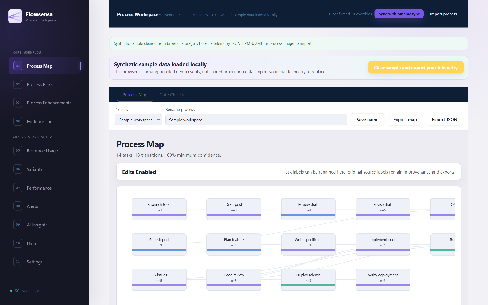

# FlowSensa

Turn work telemetry — from people, AI agents, and systems — into process maps, risks, and improvement suggestions you can check against evidence.

[**Live demo**](https://flowsensa.vercel.app) · [Telemetry guide](docs/telemetry-log-guide.md) · [Architecture](docs/architecture.md)

[](LICENSE)

## Series context

FlowSensa appears in [*Dude, Where's My Claude?*](https://henryflowers45.substack.com/p/dude-wheres-my-claude) ([LinkedIn post](https://www.linkedin.com/posts/henry-flowers_fable5-aisovereignty-localai-activity-7480372630135418882-WWUd)), part of the *Looping in the Human* series.



## Features

- Process maps discovered from event logs, with confirmable steps and transitions
- Process risks and enhancement suggestions, each tied to the evidence behind them
- Resource usage, variants, and performance views across human, agent, and system work
- Deterministic process-mining core — no model key required
- Optional AI insights through your own OpenAI-compatible key (kept in memory, never stored)
- Sourcing breakeven: pay-per-token vs pay-per-compute from your own telemetry
- Exportable process report — a self-contained HTML one-pager, no external requests

## Quick start

```bash
npm ci
npm run dev
```

Open http://localhost:5173 and click **Begin demo** to load a synthetic workspace — no key or data needed.

## Bring your own telemetry

Import FlowSensa JSON work events, BPMN/XML process models, process images, or an exported FindMnemo process file. The public app does not connect to FindMnemo's operational database. Event schema, examples, and prompts: [telemetry guide](docs/telemetry-log-guide.md).

## Privacy

- Workspace data stays in your browser unless you explicitly import or export it.
- API keys live in session memory only — never in local storage, exports, or logs.

The optional server-side LLM proxy is disabled by default. Self-hosters must set `FLOWSENSA_LLM_PROXY_ENABLED=1` and explicitly allow provider hostnames with `FLOWSENSA_LLM_ALLOWED_HOSTS`; add a durable edge rate limit before exposing it publicly.

## License

[MIT](LICENSE)
